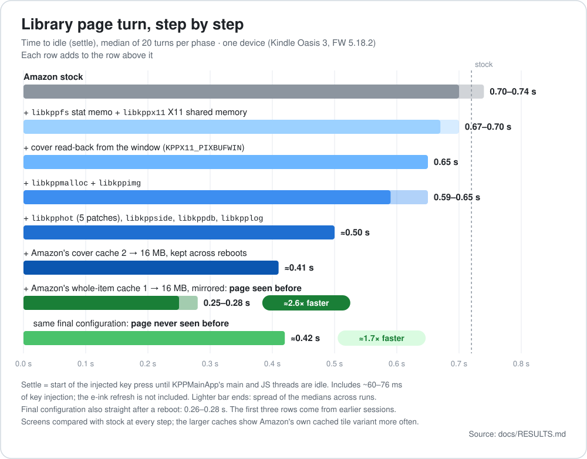
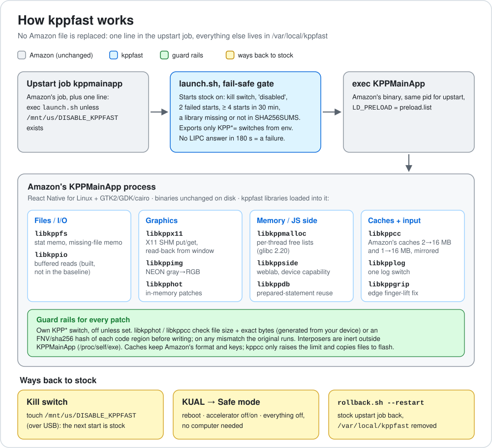
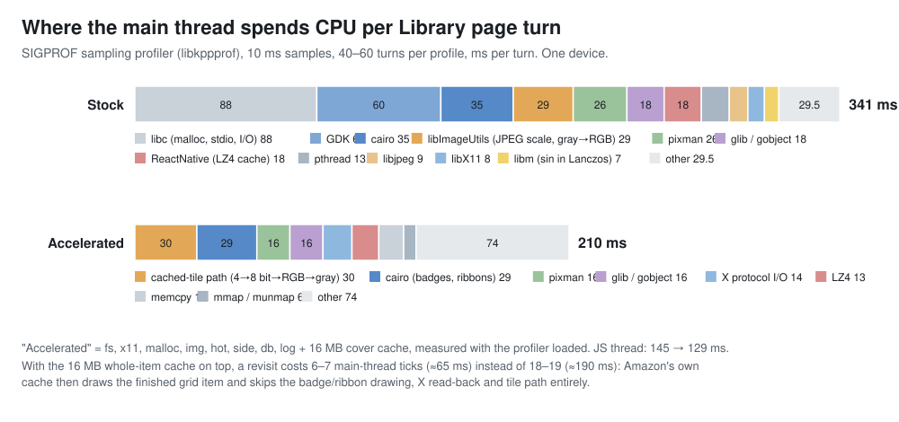

# Kindle Oasis 3 UI speed-up (kppfast)

[Reproduce](docs/REPRODUCE.md) · [Results](docs/RESULTS.md) · [Methodology](docs/METHODOLOGY.md)

> **Disclaimer.** This is educational and research documentation of the author's personal experiments on their own
> device. It is not an encouragement or an instruction to modify devices. Modifying a Kindle may violate Amazon's
> terms of use, voids the warranty and can brick the device. There is no support. Use it entirely at your own risk.
> The project does not circumvent DRM or access protected content and must not be used to do so. Respect Amazon's
> copyrights and trademarks. Not affiliated with or endorsed by Amazon. Amazon and Kindle names are used only
> descriptively.

The Library of a Kindle Oasis 3 (firmware 5.18.2) turns pages slowly, about 0.7 s per page. This repository holds
the author's own code that speeds up Amazon's stock `KPPMainApp` without replacing a single Amazon file: small
`libkpp*.so` libraries loaded with `LD_PRELOAD`, a fail-safe launcher, a benchmark harness and a KUAL "Safe mode"
extension.

## Results (one device, medians)

| | Amazon | kppfast |
|---|---|---|
| Library page turn, revisit | 0.59–0.74 s | **≈0.25 s** |
| Library page turn, first visit | 0.65–0.74 s | **≈0.42 s** |
| Main-thread CPU per turn | 341 ms | 210 ms (≈65 ms on a revisit) |
| Page turn while selecting text across pages | ≈1.25 s, then hangs | ≈0.94–1.0 s, no hang |

Screens are pixel-identical to stock (with one documented cover-cache case, see [RESULTS](docs/RESULTS.md)).

## How it works

- **LD_PRELOAD.** One line is added to the `kppmainapp` upstart job: unless `/mnt/us/DISABLE_KPPFAST` exists it runs
  `launch.sh`, which verifies every library against `SHA256SUMS` and `exec`s `/app/bin/KPPMainApp` with `LD_PRELOAD`.
  Amazon binaries, `/opt/amazon` and `cc.db` are not touched.
- **Interposed functions.** `libkppfs` caches `stat`/`open` and negative lookups, `libkppx11` moves image transfers
  to X11 shared memory, `libkppmalloc` gives glibc 2.20 per-thread free lists, `libkppimg` replaces a slow gray→RGB
  loop with NEON, `libkppside` and `libkppdb` remove needless JS-thread work, `libkpplog` silences log spam with
  one switch.
- **Byte-verified in-memory patches.** `libkpphot` and `libkppcc` change a few instructions in the loaded code only
  after the file size and the exact bytes of every site match. The expected bytes are **not shipped**: you generate
  them from your own device (`tools/genbytes.py`) or check by hash. Any mismatch skips the patch and the original runs.
- **Amazon's own caches un-starved.** The biggest gain came from stock caches, not new code: on this device the
  cover-tile cache is capped at 2 MB (≈6 pages) and the whole-item cache at 1 MB (2–3 pages). `libkppcc` raises both
  to 16 MB (a value the firmware itself uses on devices with more RAM) and mirrors finished cache files to flash so
  they survive reboots.
- **Text selection.** The touch driver's grip suppression swallows a finger lift near the right and bottom edges
  (≈40 px), so selecting across a page hung. `libkppgrip` switches suppression off for the duration of the gesture
  only; `KPPHOT_RSEL_EDGE=700` shortens the edge hold from 1000 to 700 ms. See the
  [diagram](docs/img/cross-page-selection.svg).

## Safety

- Every patch has its own `KPP*=1` switch, default off.
- `launch.sh` starts stock if: `/mnt/us/DISABLE_KPPFAST` exists, 2 failed starts, 4 starts within 30 min, a library
  does not match `SHA256SUMS`. A hang (no LIPC answer in 180 s) counts as a failure.
- Without a computer: KUAL → "Safe mode" (reboot, accelerator off/on, everything off).
- Full rollback: `sh /var/local/kppfast/rollback.sh --restart` restores the stock upstart job and removes
  `/var/local/kppfast`.

## Parity

A speed-up counts only if screens and behaviour match stock: screenshots on the same pages (Library, Home, a book
page, quick settings; status bar masked), cache files compared, a behaviour pass (sort, list view, filter). See
[METHODOLOGY](docs/METHODOLOGY.md).

## What did not work (honest list)

- `KPPLOG=2` (also dropping ~60 freeze-detector lines per turn): no gain.
- `KPPCC_LZ4=1` (own fast LZ4 decoder for cache tiles): no gain; the LZ4 time in the profile was compression on first visits.
- Faster quick settings (`libkppqs`, shorter window timers): caused a second screen update, rejected.
- Patching the Java reader: on the device books are rendered by KUX inside KPPMainApp, the Java reader is not used.
- Rebuilding cairo, swapping pixman/libjpeg, a thread pool instead of `std::thread`: more risk than gain, not done.
- `libkppio` (buffered reads) is built and unit-tested but was not measured on the device; not in the baseline.
- First visit of a page (~0.42 s) is bound by reading the cover back from X; pre-filling the cache was not achieved.

## Install

Kindle Oasis 3 on firmware 5.18.2 only, entirely at your own risk. Jailbreaking is not part of this project and is
not linked. Steps: [docs/REPRODUCE.md](docs/REPRODUCE.md).

## Layout

`src/` library sources · `tools/` expected-bytes generator, Hermes bytecode tool · `install/` launcher, installer,
rollback · `bench/` benchmark harness · `safemode/` KUAL extension · `docs/` methodology, results, images ·
`build.sh` Docker build.

## License

[PolyForm Noncommercial 1.0.0](LICENSE.md) and [NOTICE](NOTICE.md): noncommercial use only; derivative works and
forks must keep the Required Notice and link to the original project. The license covers only the author's original
code and documentation and grants no rights to Amazon firmware, binaries, books or trademarks.

Copyright 2026 Artyom Lemelson (https://github.com/Lemelson)
