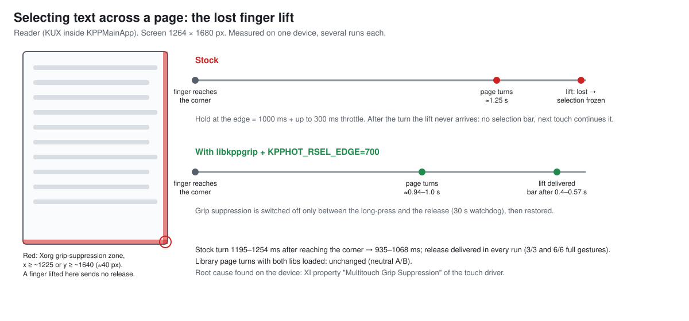

# Results

All numbers: one Kindle Oasis 3, FW 5.18.2, the author's own library (~480 items), measured 18–19.11.2026.
Library page turn ("settle") = from the start of the injected key press until KPPMainApp's main and JS threads have
been idle for 150 ms (end of the last busy sample; the e-ink refresh is not included, the ~60–76 ms of key injection
is). **Median of 20 turns per phase**, interleaved A/B runs (baseline B and candidate N alternate: B N B N, or longer).
"fwd new" = first visit of a page in this process (with the persistent caches of the final configuration this can
still be a cache hit), "fwd again" = revisit forward, "back" = revisit backward. Ticks = 10 ms of CPU from
`/proc/<pid>/stat`. Numbers on another device or library will differ.

"Amazon stock" means: no kppfast library loaded. The test device's `KPPMainAppV2` was not byte-identical to the stock
5.18.2 file: it carried an unrelated modification (about 36 KB of data, outside every code region this project checks
or patches; those regions are identical to stock, see `EXPECTED-HASHES.txt`, which lists the stock file).

## Library page turn, step by step

| step (cumulative) | median settle | evidence |
|---|---|---|
| Amazon stock | 0.70–0.74 s | stock runs of 18.11 |
| + libkppfs + X11 SHM (`libkppx11`) | 0.67–0.70 s | A/B vs stock |
| + cover read-back from the GdkWindow (`KPPX11_PIXBUFWIN`) | 0.65 s | A/B |
| + libkppmalloc + libkppimg | 0.59–0.65 s | old baseline B: 647/624/624, 649/593/624 ms |
| + libkpphot (5 patches) + libkppside + libkppdb + libkpplog | ≈0.50 s | L: 508/494/471, 493/470/474, 503/469/460 ms |
| + libkppcc: Amazon's cover cache 2 → 16 MB, kept across reboots | ≈0.41 s | X: 422/413/405, 421/413/404, 415/397/406 ms vs B 737/588/609, 635/600/594 |
| + Amazon's whole-item cache 1 → 16 MB (`KPPCC_BOOK_MB=16`, mirrored) | 0.25–0.28 s on pages seen before, ≈0.42 s on a page's first ever visit | K: 409/269/258, 420/256/262, 415/254/254 ms vs X 426/408/408, 425/415/399; final config steady state 274/266/269, 268/263/276 ms |

The first three rows come from earlier sessions whose raw runs are not reproduced here.
Single candidates measured alone before combining: hot −22…−43 ms, side (with its own log drop) −40…−73 ms, db −26 ms;
together with the log switch −140…−155 ms on new pages and −125…−160 ms on revisits, ~100 ms less process CPU per turn.
Steady state with the item cache (final configuration): settle 263–276 ms, also for "fwd new" and straight after a
reboot (276/264/260 ms), because the mirrored caches already hold the pages; from the moment the key was delivered:
≈200–212 ms (X: 342–361 ms).
VmRSS after 3 turns: 68.8–75.7 MB in every configuration, no trend by configuration.

## Where the time goes

Stock profile (60 turns, SIGPROF, `src/kppprof`): 542 ms CPU per turn, of which main thread 341 ms, JS thread 145 ms,
native queue 24 ms. Main thread by library: libc 88 (glibc 2.20 malloc without tcache, stdio, `/proc` reads of the
freeze detector), GDK 60, cairo 35, libImageUtils 29, pixman 26, glib/gobject 18, libReactNative 18 (LZ4 of the cover
cache), pthread 13.5, libjpeg 9, libX11 8, libm 7 (`sin` in the Lanczos kernel).

With fs, x11, malloc, img, hot, side, db, log and the 16 MB cover cache, before the item cache (40 turns, profiler
loaded): main 210 ms, JS 129 ms, native 22 ms. No big single item left: cached-tile path ~30 ms, cairo 29 + pixman 16 (vector badges),
glib/gobject 16, X protocol I/O ~14, LZ4 13, memcpy 12. The whole-item cache then removes most of that on revisits:
main thread 6–7 ticks (60–70 ms) instead of 18–19.

## Cross-page text selection (reader)

- Stock: long-press → word highlighted at 564 ms; finger at the corner → page turn 1195–1254 ms later
  (1000 ms edge hold + up to 300 ms selection-update throttle). After the turn the finger lift was lost: no selection
  bar, the next touch continued the old selection.
- Root cause (device): the touch driver's grip suppression drops the button release of a finger lifted at
  x ≥ ~1225 or y ≥ ~1640. With suppression off the release arrives at the edge and the corner.
- `libkppgrip` (`KPPGRIP=1`) switches suppression off between the long-press and the release (30 s watchdog) and
  restores it. `KPPHOT_RSEL_EDGE=700` makes the edge hold 700 ms.
- Result (first version of `libkppgrip`): release delivered in every run (3/3 with the stock 1000 ms hold, 6/6 full
  gestures with 700 ms); page turn 935–1068 ms after reaching the corner with 700 ms; selection bar 369–569 ms after
  lifting. Library A/B with both: neutral.
- **The `libkppgrip` source in this repository is a later, hardened rewrite (reader-window gate, crash-safe restore,
  no polling).** It passed its 41 unit checks but failed its first device test: the release arrived, yet there was no
  page turn and no selection bar in the first two full gestures, so the device went back to the first version. Treat
  `KPPGRIP=1` with this source as experimental and untested on a device.

## Parity

- Emulator (same firmware under QEMU): hot + side + db vs the previous baseline (fs, x11, malloc, img, which matched
  stock 22/22 in an earlier emulator run) 22/22 screens identical, cover cache files 46/46 identical (uninitialised
  header bytes masked), reference pairs 22/22; behaviour pass 12/12 steps.
- Device: 12 restart cycles in mixed order, hot = db = hot+side+db = baseline, 0 px difference on Home and Library
  pages; search bar region identical in all 12 runs.
- Caches: Amazon stores cover tiles 4-bit quantised, so a tile drawn from the cache differs from a freshly decoded one
  by 1–33/255 (under 2 of 16 grey levels) on some pixels. Stock itself shows either variant depending on its cache
  state (old baseline vs old baseline: 11/22 screens identical). With 16 MB the cached variant is simply shown more
  often; the device owner accepted this. So the larger caches are not pixel-identical to a given stock run, only to
  one of the two variants stock produces. With the 16 MB cover cache, steady state: 13/13 screens 0 px different
  between runs. With the item cache added (final config): three runs identical to each other on 13/13 screens; versus
  the configuration without it 11/13 identical, 2 screens differ in 104/129 px of the partly visible bottom row (the
  same cached-variant class).
- Crash on exit: Amazon's app often crashes in its shutdown path when it is killed deliberately (one day's count:
  18 of 73 kills over all configurations; earliest baseline with only fs/x11/malloc/img 4 of 21, with the cover cache
  0 of 9). The rate shows no link to any library; pure stock was not counted in the same way.

## Did not pay off

| idea | result |
|---|---|
| `KPPLOG=2` (switch exists, off; also drop ~60 freeze-detector lines per turn) | 462/486 vs 481/469 ms, no gain |
| `KPPCC_LZ4=1` (switch exists, off; own LZ4 decoder for cache tiles, differential-tested vs firmware decoder) | 412/415/408 vs 420/416/406 ms, no gain |
| quick-settings timers (`libkppqs`, not in this repository) | second screen update on first open, rejected |
| Java reader patch (selection timers, not in this repository) | not used on the device (KUX renders books), dead end |
| `libkppio` (buffered reads) | built, 25/25 unit checks, not measured on the device |
| book open: send KPPMainApp's open request before the Java listeners (Java patch, not in this repository) | 1240 → 1193 ms median warm open (−4 %), parity clean on one test book; not shipped |
| book open: lazy navigation data (Java patch, not in this repository) | no gain (needed before the listeners anyway) |
| book open: run non-display Java listeners after the page is shown | built, never validated on the device (expected −10–12 %) |
| wake from sleep: one full refresh instead of two | not done; ~0.45 s faster but may leave ghosting of the screensaver cover |

### Measured but unchanged

| scenario | median | notes |
|---|---|---|
| book open, already opened before | ~1.24 s to page fully shown | ~0.5 s Java reader before the page may be shown; ~0.34 s e-ink |
| book open, first ever after a boot | ~4.3–5.0 s | |
| reader page turn | ~0.115 s to first screen write, ~0.48 s e-ink done | text and image-heavy books alike |
| quick-settings panel | shown at ~0.88–0.92 s | window-manager timer + one full refresh |
| wake from sleep (power button) | page clean ~1.0 s, settled ~1.3 s (p90 1.33 s) | two full refreshes + one partial |
| sleep (power button) | ~3.1 s to screensaver shown | includes an 800 ms delay inside the screensaver program |
