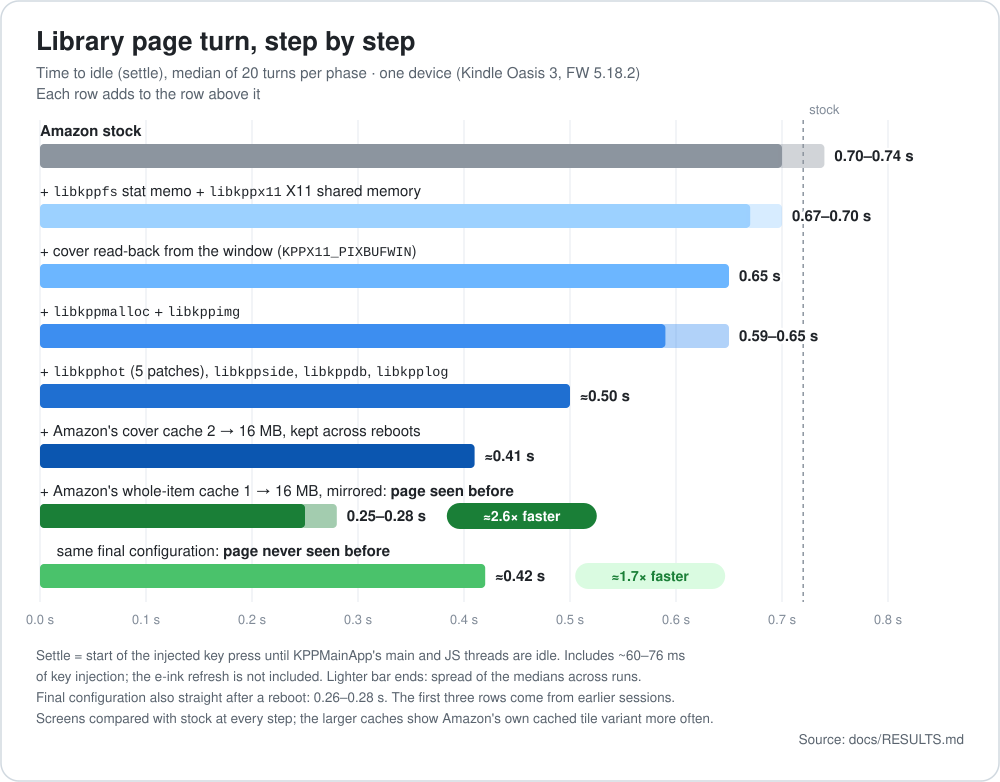
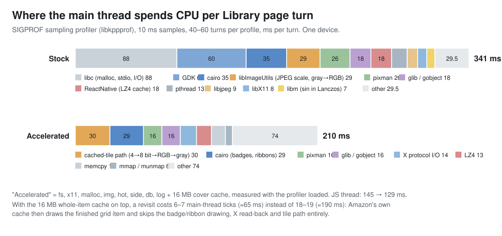

# Results

All numbers: one Kindle Oasis 3, FW 5.18.2, the author's own library (~480 items), measured 18–19.11.2026.
Library page turn = key press injected → screen settled (process idle), **median of 20 turns per phase**,
interleaved A/B runs (baseline B and candidate N alternate: B N B N, or longer). "fwd new" = first visit of a page in
this process, "fwd again" = revisit forward, "back" = revisit backward. Ticks = 10 ms of CPU from `/proc/<pid>/stat`.
Numbers on another device or library will differ.

## Library page turn, step by step

| step (cumulative) | median settle | evidence |
|---|---|---|
| Amazon stock | 0.70–0.74 s | stock runs of 18.11 |
| + libkppfs + X11 SHM (`libkppx11`) | 0.67–0.70 s | A/B vs stock |
| + cover read-back from the GdkWindow (`KPPX11_PIXBUFWIN`) | 0.65 s | A/B |
| + libkppmalloc + libkppimg | 0.59–0.62 s | old baseline B: 647/624/624, 649/593/624 ms |
| + libkpphot (5 patches) + libkppside + libkppdb + libkpplog | ≈0.50 s | L: 508/494/471, 493/470/474, 503/469/460 ms |
| + libkppcc: Amazon's cover cache 2 → 16 MB, kept across reboots | ≈0.41 s | X: 422/413/405, 421/413/404, 415/397/406 ms vs B 737/588/609, 635/600/594 |
| + Amazon's whole-item cache 1 → 16 MB (`KPPCC_BOOK_MB=16`, mirrored) | ≈0.25 s on revisits, ≈0.42 s first visit | K: 409/269/258, 420/256/262, 415/254/254 ms vs X 426/408/408, 425/415/399 |

Single candidates measured alone before combining: hot −22…−43 ms, side −40…−73 ms, db −26 ms; together with the log
switch −140…−155 ms on new pages and −125…−160 ms on revisits, ~100 ms less process CPU per turn.
Steady state with the item cache: settle 263–276 ms on revisits; inject → settled ≈200–210 ms (X: 342–361 ms).
VmRSS after 3 turns: 68.8–75.7 MB in every configuration, no trend by configuration.

## Where the time goes

Stock profile (60 turns, SIGPROF, `src/kppprof`): 542 ms CPU per turn, of which main thread 341 ms, JS thread 145 ms,
native queue 24 ms. Main thread by library: libc 88 (glibc 2.20 malloc without tcache, stdio, `/proc` reads of the
freeze detector), GDK 60, cairo 35, libImageUtils 29, pixman 26, glib/gobject 18, libReactNative 18 (LZ4 of the cover
cache), pthread 13.5, libjpeg 9, libX11 8, libm 7 (`sin` in the Lanczos kernel).

With fs, x11, malloc, img, hot, side, db, log and the 16 MB cover cache (40 turns, profiler loaded): main 210 ms,
JS 129 ms, native 22 ms. No big single item left: cached-tile path ~30 ms, cairo 29 + pixman 16 (vector badges),
glib/gobject 16, X protocol I/O ~14, LZ4 13, memcpy 12. The whole-item cache then removes most of that on revisits:
main thread 6–7 ticks instead of 18–19.

## Cross-page text selection (reader)

- Stock: long-press → word highlighted at 564 ms; finger at the corner → page turn 1195–1254 ms later
  (1000 ms edge hold + up to 300 ms selection-update throttle). After the turn the finger lift was lost: no selection
  bar, the next touch continued the old selection.
- Root cause (device): the touch driver's grip suppression drops the button release of a finger lifted at
  x ≥ ~1225 or y ≥ ~1640. With suppression off the release arrives at the edge and the corner.
- `libkppgrip` (`KPPGRIP=1`) switches suppression off between the long-press and the release (30 s watchdog) and
  restores it. `KPPHOT_RSEL_EDGE=700` makes the edge hold 700 ms.
- Result: release delivered in every run (3/3, 6/6 full gestures); page turn 935–1068 ms after reaching the corner;
  selection bar 369–569 ms after lifting. Library A/B with both: neutral.

## Parity

- Emulator (same firmware under QEMU): hot + side + db vs stock 22/22 screens identical, cover cache files 46/46
  identical (uninitialised header bytes masked), stock-vs-stock reference 22/22; behaviour pass 12/12 steps.
- Device: 12 restart cycles in mixed order, hot = db = hot+side+db = baseline, 0 px difference on Home and Library
  pages; search bar region identical in all 12 runs.
- Caches: Amazon stores cover tiles 4-bit quantised, so a tile drawn from the cache differs from a freshly decoded one
  by 1–33/255 on some pixels. Stock itself shows either variant depending on its cache state (stock vs stock: 11/22
  screens identical). With 16 MB the cached variant is simply shown more often. Steady state of the final config:
  13/13 screens 0 px different between runs.
- Crash on exit: Amazon's app crashes on about every second deliberate kill, with or without the libraries
  (stock 2 of 4, with all libraries 0 of 2 in one series). Not caused by this project.

## Did not pay off (switches exist, default off)

| idea | result |
|---|---|
| `KPPLOG=2` (also drop ~60 freeze-detector lines per turn) | 462/486 vs 481/469 ms, no gain |
| `KPPCC_LZ4=1` (own LZ4 decoder for cache tiles, differential-tested vs firmware decoder) | 412/415/408 vs 420/416/406 ms, no gain |
| quick-settings timers (`libkppqs`) | second screen update on first open, rejected |
| Java reader patch (selection timers) | not used on the device (KUX renders books), dead end |
| `libkppio` (buffered reads) | built, 25/25 unit checks, not measured on the device |
